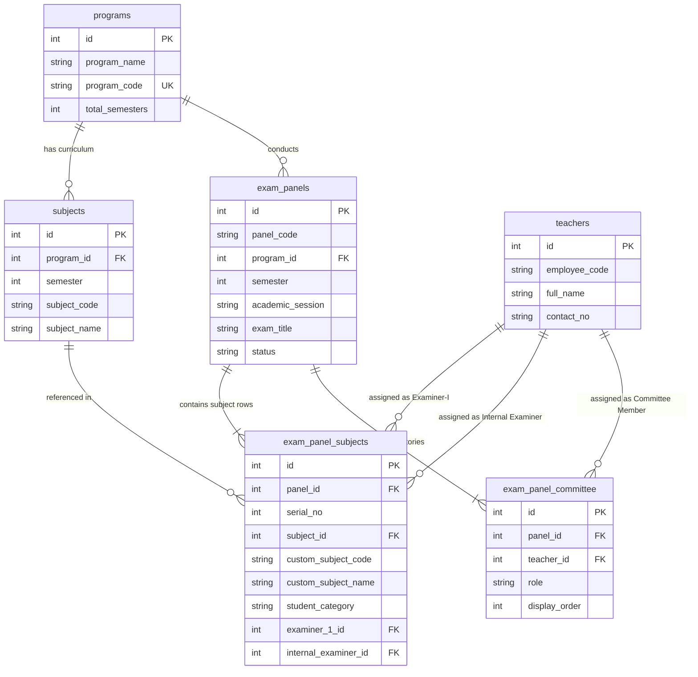

# SDSF Exam Cell V2.0 - Examination Panel Database Schema

This repository manages the automated examination workflows for the **School of Data Science and Forecasting (SDSF)**, Devi Ahilya Vishwavidyalaya, Indore.

This document details the database architecture designed for generating, storing, and printing the **Panel of Examiners (Confidential - SDSF/Exam/09)** form.

> [!IMPORTANT]
> **Developer Notice & Intellectual Property Rights**  
> This project serves strictly as an informational and architectural reference for authorized developers. This project, its source code, and its underlying database designs shall **not** be copied, replicated, redistributed, or reciprocated in any manner without prior authorization.  
> **All Rights Reserved © SDSF - School of Data Science and Forecasting, Devi Ahilya Vishwavidyalaya (DAVV), Indore.**

---

**Lead Developer & Architect:** Joyobrata Das ([@holycompile](https://github.com/holycompile))  
**Organization:** School of Data Science and Forecasting, Devi Ahilya Vishwavidyalaya, Indore  
**Project:** SDSF Exam Cell Automation System V2.0  

---

## 1. Entity Relationship (ER) Overview



---

## 2. Table Specifications

### A. Master Tables (Curriculum & Faculty Data)

#### 1. `programs`
Defines academic programs (e.g., M.Tech in AI & Data Science, M.Sc, etc.).
* **`id`** (`INT`, Primary Key, Auto-Increment): Unique program identifier.
* **`program_name`** (`VARCHAR(150)`, Not Null): Full name of the degree (e.g., `"M.Tech. (AI & DS)"`).
* **`program_code`** (`VARCHAR(50)`, Unique, Not Null): Identifier code (e.g., `"MTECH-AIDS"`).
* **`total_semesters`** (`INT`, Not Null): Total duration in semesters (e.g., `6`).

#### 2. `teachers`
Stores faculty members eligible to serve as examiners or committee signatories.
* **`id`** (`INT`, Primary Key, Auto-Increment): Unique faculty identifier.
* **`employee_code`** (`VARCHAR(50)`, Nullable): University employee ID (e.g., `"SDSF1000"`).
* **`full_name`** (`VARCHAR(150)`, Not Null): Full name of the faculty member (e.g., `"Mr. Rajat Yadav"`).
* **`contact_no`** (`VARCHAR(20)`, Nullable): Mobile / phone number displayed beneath teacher names.

#### 3. `subjects`
Maintains the syllabus mapping of subjects to their respective program and semester.
* **`id`** (`INT`, Primary Key, Auto-Increment): Unique subject identifier.
* **`program_id`** (`INT`, Foreign Key $\rightarrow$ `programs.id`): Parent degree program.
* **`semester`** (`INT`, Not Null): Semester number (e.g., `5`).
* **`subject_code`** (`VARCHAR(50)`, Not Null): Course code (e.g., `"DS6A-301"`).
* **`subject_name`** (`VARCHAR(255)`, Not Null): Official subject title (e.g., `"Datamining and Data Warehousing"`).

---

### B. Transaction Tables (Exam Panel Submissions)

#### 4. `exam_panels`
Parent record representing an official examination panel document for a specific semester and academic year.
* **`id`** (`INT`, Primary Key, Auto-Increment): Primary key for the panel.
* **`panel_code`** (`VARCHAR(50)`, Default: `'SDSF/Exam/09'`): Institutional form reference.
* **`program_id`** (`INT`, Foreign Key $\rightarrow$ `programs.id`): Course being examined.
* **`semester`** (`INT`, Not Null): Semester number.
* **`academic_session`** (`VARCHAR(50)`, Not Null): Academic term (e.g., `"2025-2026"` or `"DEC-2025"`).
* **`exam_title`** (`VARCHAR(100)`, Default: `'Theory / Comprehensive Viva'`): Examination header.
* **`status`** (`VARCHAR(30)`, Default: `'Draft'`): Form lifecycle (`'Draft'`, `'Submitted'`, `'Approved'`).
* **`created_at`** / **`updated_at`**: Timestamps for auditing.

#### 5. `exam_panel_subjects`
Stores each subject row displayed in the main table of the panel document.
* **`id`** (`INT`, Primary Key, Auto-Increment): Unique row ID.
* **`panel_id`** (`INT`, Foreign Key $\rightarrow$ `exam_panels.id` with `CASCADE`): Parent panel.
* **`serial_no`** (`INT`, Not Null): Display index (`1, 2, 3...`).
* **`subject_id`** (`INT`, Nullable, Foreign Key $\rightarrow$ `subjects.id`): References curriculum subject (set to `NULL` for custom ad-hoc papers).
* **`custom_subject_code`** (`VARCHAR(50)`, Nullable): Fallback code when using the `+ Add Subject / Paper Row` feature.
* **`custom_subject_name`** (`VARCHAR(255)`, Nullable): Fallback name for custom added papers.
* **`student_category`** (`VARCHAR(10)`, Default: `'RE'`): `'RE'` (Regular) or `'EX'` (Ex-student).
* **`examiner_1_id`** (`INT`, Foreign Key $\rightarrow$ `teachers.id`): Selected Examiner-I.
* **`internal_examiner_id`** (`INT`, Foreign Key $\rightarrow$ `teachers.id`): Selected Internal Examiner.

#### 6. `exam_panel_committee`
Captures the exam committee members and administrative signatories at the bottom of the sheet.
* **`id`** (`INT`, Primary Key, Auto-Increment): Unique row identifier.
* **`panel_id`** (`INT`, Foreign Key $\rightarrow$ `exam_panels.id` with `CASCADE`): Associated panel.
* **`teacher_id`** (`INT`, Foreign Key $\rightarrow$ `teachers.id`): Faculty member assigned to the role.
* **`role`** (`VARCHAR(100)`, Not Null): Signatory title (`"Member 1"`, `"Member 2"`, `"Member 3"`, `"Chairman BOS"`, `"Coordinator"`, `"Head"`, `"Vice Chancellor"`).
* **`display_order`** (`INT`, Not Null): Ordering sequence (`1` to `7`) to preserve the printable grid layout.

---

## 3. Key Design Features

1. **Session Isolation (`academic_session`)**:
   Prevents overwriting past years' records. Each year's semester panel is stored as an independent record while reusing master subjects and faculty.
2. **Dynamic Row Support (`+ Add Subject / Paper Row`)**:
   By allowing `subject_id` to be nullable and pairing it with `custom_subject_code` and `custom_subject_name`, the system gracefully handles special, elective, or backlog papers without altering the permanent syllabus master.
3. **Flexible Dual Assignments**:
   Faculty members can be assigned as both **Examiner-I** and **Internal Examiner** on the same row when required by department policy.
4. **Referential Integrity**:
   Foreign keys use `ON DELETE CASCADE` for panel line items and committee entries so that cleaning up or purging a draft panel removes all its associated child rows cleanly.

---

## 4. How to Initialize the Schema in TiDB Cloud

1. Ensure your `.env` contains your TiDB Cloud credentials (`TIDB_HOST`, `USERNAME`, `PASSWORD`, `DATABASE`).
2. Add your SQL `CREATE TABLE` statements to `databases/schema.sql`.
3. Run the automated database initializer:
   ```powershell
   python databases/init_db.py
   ```
4. All 6 tables will be created and verified inside your TiDB Cloud cluster.

---

## 5. Proprietary Notice & Legal Disclaimer

This repository is maintained for internal examination and academic management purposes. Unauthorized reproduction, dissemination, or commercial exploitation of this software or its schemas is strictly prohibited.

* **Lead Developer:** Joyobrata Das ([@holycompile](https://github.com/holycompile))
* **Affiliation:** School of Data Science and Forecasting, Devi Ahilya Vishwavidyalaya (DAVV), Indore  
* **Copyright:** All Rights Reserved © SDSF - School of Data Science and Forecasting, DAVV Indore.


